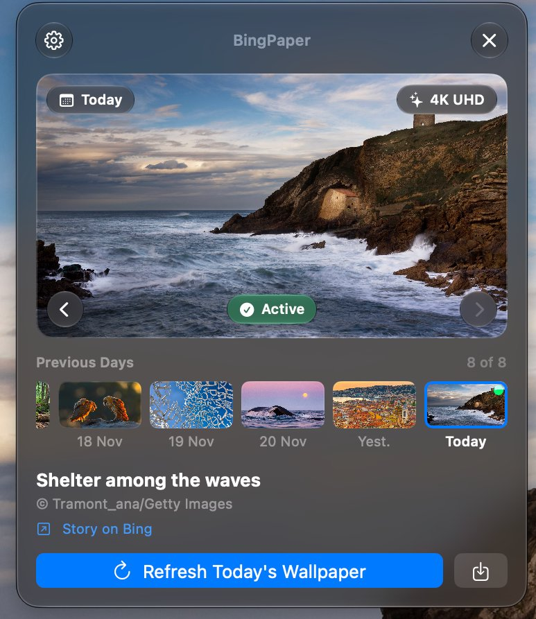

# BingPaper

**Bing daily wallpaper for macOS that actually works.**

Most Bing wallpaper apps break on modern macOS — leaving inactive Spaces stale, ignoring the Lock Screen, or reverting back to the default wallpaper. BingPaper updates macOS's native wallpaper store properly so your 4K daily wallpaper sticks across every display, Space, and Lock Screen.

<p align="center">
  
</p>

<p align="center">
  <a href="https://buymeacoffee.com/sevasdreas">
    
  </a>
</p>

## Why BingPaper

- **Actually updates everything** — applies 4K UHD Bing wallpapers across all displays, active & inactive Spaces, and the Lock Screen.
- **Choose your target** — apply to **All Screens, Spaces & Lock Screen**, **Screens & Spaces Only**, or **Lock Screen Only**.
- **Never misses a day** — updates on schedule and catches up automatically after sleep, reboot, or offline time.
- **Browse previous days** — preview and switch back to recent Bing wallpapers right from the menu bar.
- **Native macOS app** — lightweight Swift 6 / SwiftUI menu bar app built for macOS 26+ / macOS 27 with Launch at Login.

## Install

Download `BingPaper-v1.1.0-macos.zip` from [Releases](../../releases), unzip, and drag `BingPaper.app` to `/Applications`.

> First launch (ad-hoc signed): right-click `BingPaper.app` → **Open**.

Or build from source (macOS 26+, Swift Command Line Tools — no Xcode needed):

```bash
./Scripts/install.sh
open /Applications/BingPaper.app
```

---

MIT License — © 2026 Andrey Ivanov · [Buy Me a Coffee](https://buymeacoffee.com/sevasdreas)
